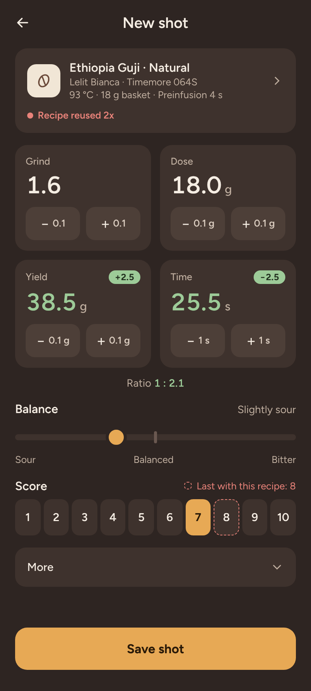
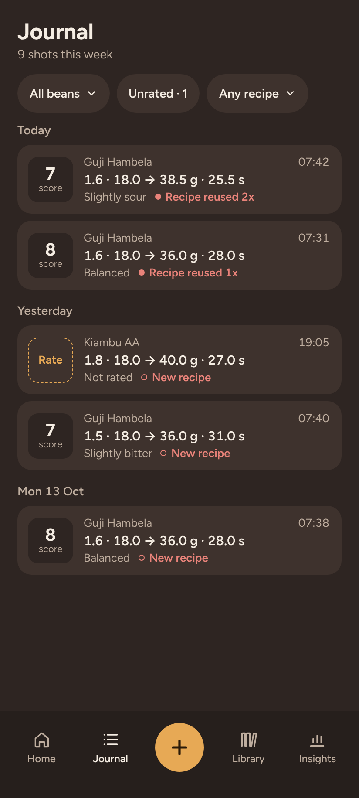
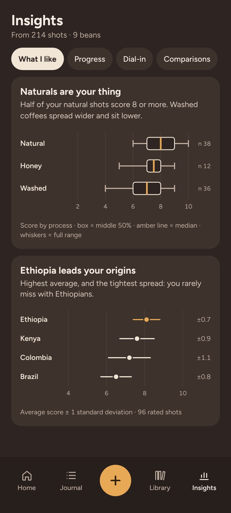

<p align="center">
  
</p>

<h1 align="center">Coffee Nerd</h1>

<p align="center">
  Data that backs up the home barista. A self-hosted espresso journal for your phone:<br>
  log a shot in seconds at the machine, see what changed, and learn which beans and recipes you like.
</p>

<p align="center">
  <a href="https://github.com/AlbertFlindt/coffee-nerd/releases/latest"></a>
  <a href="https://github.com/AlbertFlindt/coffee-nerd/actions/workflows/ci.yml"></a>
  <a href="#license"></a>
</p>

<p align="center">
  <a href="#features">Features</a> ·
  <a href="#requirements">Requirements</a> ·
  <a href="#installation">Installation</a> ·
  <a href="#back-up-and-restore">Back up and restore</a> ·
  <a href="#running-from-source">Running from source</a>
</p>

<p align="center">
  
  
  
</p>

| Feature | What it does |
|---|---|
| **Shot form** | Starts from your best recipe, so a shot is a few taps. Shows what changed and whether you reused a recipe. |
| **Journal** | Every shot by day, filtered by bean, recipe or unrated. Open one to see, edit or delete it. |
| **Library** | Your beans, gear (machines, grinders, baskets), puck prep routines and flavor tags. |
| **Home** | The last shot, bean freshness, this week, the best recipe for your bean and your dial-in progress. |
| **Insights** | What you like, your progress, dial-in and fair comparisons, with σ and distributions. |
| **Offline** | Install it on your phone's home screen. It opens offline and sends shots saved offline later. |
| **Your data** | A full backup in one file, and exports as CSV and JSON. |

Coffee Nerd stores everything on your own server and makes no outside requests.

## Features

### Shot form

Each new shot starts from where you are: the recipe marked Brew next, otherwise this bean's best
recipe, otherwise your My setup defaults. Grind, dose, yield and time change with −/+ in the steps
your gear uses. Values that differ from the last shot turn green, and the recipe tag says
"Recipe reused 2x" or "New recipe · grind changed". Rate it 1–10 and set the balance, or leave
taste for later: it is never filled in for you. Setup holds the machine's features (temperature,
preinfusion, pressure profile, your own) and the puck prep routine; Tasting holds body, sweetness,
aftertaste, flavor notes and your own notes.

### Journal and shot detail

Shots grouped by day with score, recipe and taste. Filter by bean, by recipe or to the unrated
ones, and rate a shot right from the list. A shot's page shows everything about it and how it
compares with its recipe's other shots.

### Library

- **Beans:** roaster, origin, process, roast date and bag weight. "Same as before" picks up a re-buy
  where the last bag left off. Grams left count down with each shot, and a used-up bag finishes itself.
- **Gear:** machines, grinders and baskets, described by hand, so any machine fits. Add your own
  features (a number, an on/off switch or a list) and they appear on the shot form.
- **Puck prep:** steps (WDT, a puck screen, a tamp pressure) put together into routines.
- **Tags:** flavor notes by family, with a finder for near-duplicates and a merge.
- **My setup:** the gear, routine and values every new bean starts from.

Archived gear, routines and tags leave the lists, but past shots keep them.

### Home

The bean you are on, the last shot, how fresh the bean is, this week's shots and average, the best
recipe for this bean, and a graph of your score per shot while you dial in.

### Insights

Four tabs: **What I like** (your score by process and by origin), **Progress** (your weekly score
with its spread), **Dial-in** (how steady your shot time is on the best recipe, as a bell curve) and
**Comparisons** (your puck prep routines compared with the rest of the recipe held constant, and
your most consistent beans). Every card
opens with a finding in plain words, then the chart and how many shots it rests on.

### Installable and offline

Over https, add Coffee Nerd to your phone's home screen and it runs like an app. Home, the Journal
and the shot form open without a connection, and shots saved offline wait on the phone until the
server answers.

### Settings

The −/+ steps for dose, yield and time, the backup, the exports and sign-out. Open it from the gear
on Home.

## Requirements

- A server with Docker (any small Linux box or NAS is enough; the image is Linux x86-64).
- For installing on a phone and using it offline: https, usually through a reverse proxy.

## Installation

Coffee Nerd is one container with one data volume. Each release is published as
`ghcr.io/albertflindt/coffee-nerd:<version>` and `:latest`; every merge to `main` as `:main`.

1. **Start it.** Save this as `compose.yaml` in a folder called `coffee-nerd` and run
   `docker compose up -d`:

   ```yaml
   services:
     coffee-nerd:
       image: ghcr.io/albertflindt/coffee-nerd:latest
       ports:
         - '3000:3000'
       volumes:
         - data:/data
       restart: unless-stopped

   volumes:
     data:
   ```

   To stay on one version and update by hand, use a version tag such as `:1.0.1` in place of `:latest`.
2. **Create your account right away** at `http://<server>:3000`. Until then, anyone who can reach
   the server can claim the app: it has one account, and the first person to create it owns it.
   The app then walks you through your machine, grinder, basket, My setup and first bean, one step
   at a time.
3. **Put it behind https** to install it on your phone and use it offline (see below).

### Behind a reverse proxy

Point the proxy at port 3000 and forward `X-Forwarded-Proto`, so the sign-in cookie is marked
secure. If the proxy changes the host name, forward `X-Forwarded-Host` too, or forms are refused.
Caddy forwards both on its own:

```
coffee.example.com {
	reverse_proxy <server>:3000
}
```

With nginx, inside the `location` block:

```nginx
proxy_pass http://<server>:3000;
proxy_set_header Host $host;
proxy_set_header X-Forwarded-Proto $scheme;
proxy_set_header X-Forwarded-Host $host;
```

### Updating

In the `coffee-nerd` folder, run `docker compose pull && docker compose up -d`. Your shots stay in
the `data` volume, and database changes are applied when the app starts. Each release's changes are
in [CHANGELOG.md](CHANGELOG.md). Download a backup first (see below) if you want a way back.

### Password and starting over

**Password:** `docker compose exec coffee-nerd node scripts/reset-password.mjs` sets a new one and
signs out every device.

**Start over:** stop the app and delete its `data` volume (`docker volume rm coffee-nerd_data`).

### Try a pull request

Every open pull request from this repository is published as
`ghcr.io/albertflindt/coffee-nerd:pr-<number>` once its tests pass, renewed on each push and
deleted when the pull request is merged or closed. To try one before it is merged, run a second
container next to the real one, with its own data. Save this as `compose.yaml` in a folder called
`coffee-nerd-test`:

```yaml
services:
  coffee-nerd-test:
    image: ghcr.io/albertflindt/coffee-nerd:${PR_TAG:-latest}
    ports:
      - '3001:3000'
    volumes:
      - data:/data
    restart: unless-stopped

volumes:
  data:
```

To switch it to a pull request, put its tag in a `.env` file in that folder (`PR_TAG=pr-82`), run
`docker compose pull && docker compose up -d` there, and open `http://<server>:3001`. Without a
`.env` it runs the latest release.

- **Its data is its own.** A pull request can change the database, and that change is applied to the
  test data when it starts. To try one with your real shots, restore a backup into the test
  container (see below, with the volume `coffee-nerd-test_data`). If an older pull request then won't start, start the test data over:
  `docker compose down -v`.
- **Open it at another address than the real app**, such as the server's IP address when the real
  app has a name. Both use the same sign-in cookie, and a browser shares cookies between the ports
  of one address, so signing in to one would sign you out of the other.
- Over plain http it opens in the browser but doesn't install or work offline; give it its own
  https name on the reverse proxy to try that.

## Back up and restore

**Back up** in the app: Settings › **Download backup** saves the whole database as one file,
`coffee-nerd-backup-<date>.db`. Keep it somewhere private: it holds everything, including your
password in scrambled form. **Export shots** (a CSV for spreadsheets) and **Export everything**
(JSON) sit next to it.

**Restore** on the server, as a deliberate step: it replaces all data in the app with the backup.

1. Stop the app: `docker compose stop`.
2. Put the backup file in a folder on the server, open a terminal there and run, with your file's name:

   ```sh
   docker run --rm -v coffee-nerd_data:/data -v "$PWD":/backup debian:bookworm-slim sh -c \
     'rm -f /data/coffee-nerd.db-wal /data/coffee-nerd.db-shm &&
      cp /backup/coffee-nerd-backup-2026-10-30.db /data/coffee-nerd.db &&
      chown 1000:1000 /data/coffee-nerd.db'
   ```

   Removing the `-wal` and `-shm` files matters: they belong to the old database.
3. Start the app again: `docker compose start`. A backup from an older version is brought up to date when the app starts.
   Every device signs in again.

## Running from source

Needs Node 22.

```sh
npm ci
npm run db:seed        # optional: the reference setup (Demo / coffee-nerd)
npm run dev            # http://localhost:5173
npm run check && npm run lint && npm test && npm run test:e2e
docker compose up --build   # the production image on port 3000
```

SvelteKit (Svelte 5, TypeScript), SQLite with Drizzle ORM, Vitest and Playwright. How the app works
inside, from the data model to recipe matching and Insights, is in [docs/SPEC.md](docs/SPEC.md).

## Contributing

Bug reports, ideas and pull requests are welcome: see [CONTRIBUTING.md](CONTRIBUTING.md).

## Security

To report a vulnerability, see [SECURITY.md](SECURITY.md).

## Changes

See [CHANGELOG.md](CHANGELOG.md) and the [releases](https://github.com/AlbertFlindt/coffee-nerd/releases).

## License

Coffee Nerd is free software, licensed under the GNU Affero General Public License, version 3
only (AGPL-3.0-only). If you run a changed version for others over a network, you must offer them
its source. The full text is in [LICENSE](LICENSE).
