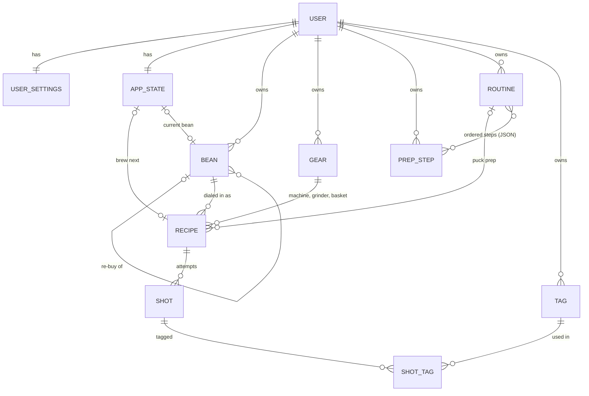

# Coffee Nerd — Data Model

Status: **agreed** · 2026-10-17
Implements D-13 (recipe vs. result), D-16 (recipe matching), D-43 (Brew next), D-46 (custom features), D-51 (step settings), D-56 (Insights statistics) and the technical decisions D-59 to D-68 in `docs/ux-decision-log.md`. The decision log wins if this document disagrees with it.

---

## 1. Principles

1. **Recipe = intent, shot = result** (D-13, D-63). A recipe is never edited. Saving a shot with different values finds or creates another recipe.
2. **History never changes** (D-65). A recipe stores a snapshot of its setup values together with the labels and units as they were.
3. **Hand-set and custom things are JSON** (D-64), each shape checked by one schema (Zod) in shared TypeScript code. Things Insights filters or groups by constantly get real columns.
4. **Decimal numbers are stored as whole numbers in thousandths.** 18.0 g is stored as `18000`, grind 1.6 as `1600`. Floating-point values drift (0.1 + 0.2 is not exactly 0.3), and drift would break recipe matching. The code converts at the edges; nobody sees thousandths in the UI.
5. **IDs are UUID version 7** strings. They can be made on the phone (needed for the offline queue, D-61), never collide, and sort by creation time.
6. **Everything a person creates has an owner** (`owner_id`). Library items also carry `shared` (off by default, no UI yet, D-60).
7. **Things that shots point to are archived, not deleted** (`archived_at`). Archived beans, gear, steps and routines disappear from pickers, but past shots keep their links. Gear and routines that My setup uses cannot be archived (D-83). A bean that no shot points to can be deleted (D-145).
8. **Times are stored in UTC** (milliseconds). The user's time zone decides what "Today" and "this week" mean; weeks start on Monday (ISO weeks).
9. **Brew method is recorded from day one.** Recipes carry `method` (only `espresso` for now, D-01), so pour-over later is an addition, not a migration.

---

## 2. Entities at a glance

| Entity | What it is | Main links |
|---|---|---|
| `user` | An account | owns everything below |
| `user_settings` | My setup defaults (D-38, D-45) and preferences | one per user; points to gear and a routine |
| `app_state` | Fast-changing state: Home's bean, Brew next, last graph | one per user; points to a bean and a recipe |
| `bean` | One bag of coffee (D-37, D-41) | may point to an earlier bag ("Same as before") |
| `gear` | A machine, grinder or basket (D-39, D-44, D-48, D-49) | used by recipes |
| `prep_step` | One puck prep step and its setting (D-52) | used inside routines |
| `routine` | An ordered list of steps with values (D-51) | used by recipes |
| `recipe` | What you set: bean, gear, routine, grind, dose, setup (D-13, D-63) | has many shots |
| `shot` | What you got: yield, time, taste (D-13) | belongs to one recipe |
| `tag` | A flavor note in a fixed family (D-53) | linked to shots |
| `shot_tag` | Which flavor notes a shot has | shot ↔ tag |



---

## 3. Entities in detail

Every table also has `created_at` and `updated_at`. Decimal quantities are in thousandths (principle 4).

### `user`
`id`, `name`, `email` (optional, unused for now, D-85), `password_hash`.

### `session` (D-86)
`id` (a hash of the token in the sign-in cookie; the token itself is never stored), `user_id`, `expires_at`. Renewed on each visit; deleted on sign-out and by the password reset (D-87).

### `user_settings` — My setup (D-38, D-45)
| Column | Notes |
|---|---|
| `user_id` | primary key |
| `default_machine_id`, `default_grinder_id`, `default_basket_id` | → `gear` |
| `default_routine_id` | → `routine` |
| `default_grind`, `default_dose`, `default_yield` | starting values for a bean's first shot |
| `default_features` | JSON, same shape as a recipe's feature values (temperature, pressure profile) |
| `time_zone` | IANA name, e.g. `Europe/Copenhagen` |
| `dose_step`, `yield_step`, `time_step` | −/+ steps for the shot form and Edit My setup; default 100, 100 and 1000 (0.1 g, 0.1 g, 1 s) (D-89) |

### `app_state`
| Column | Notes |
|---|---|
| `user_id` | primary key |
| `current_bean_id` | Home's bean scope (D-32) |
| `brew_next_recipe_id` | D-43. One column, so there can only ever be one mark |
| `home_graph` | last chosen graph on Home (D-32) |
| `basket_step_skipped` | D-157. The step-by-step start's basket step was skipped, so it is not asked again |
| `next_routine_id` | D-187. Set by "Use it for new shots"; the next shot starts with this routine. Cleared by the next saved shot, and by saving My setup with another routine. No foreign key; ignored when archived or gone |

Kept apart from settings because it changes with almost every visit.

### `bean` (D-35, D-37, D-40, D-41)
| Column | Notes |
|---|---|
| `id`, `owner_id`, `shared` | |
| `rebuy_of_id` | → `bean`. Set by "Same as before" |
| `name` | required |
| `roaster`, `region`, `variety` | optional text |
| `country_code` | ISO 3166-1 two-letter code from the country picker |
| `process` | `washed` · `natural` · `honey` · `anaerobic` · `other` |
| `altitude_min_m`, `altitude_max_m` | optional; one value fills both |
| `roast_level` | `light` · `medium_light` · `medium` · `dark` |
| `roast_date` | required, a calendar date |
| `bag_weight` | optional (D-35) |
| `status` | `open` · `finished` |
| `finished_at`, `finished_automatically` | the second one drives the undo message (D-40) |

**Never stored, always calculated:** roast age, grams left (bag weight minus the doses of its shots), best score, number of recipes and shots.

### `gear` (D-39, D-44, D-48, D-49)
One table for all Gear, because Gear is one concept (D-39, D-68). A future kind (scales, D-47) needs a new spec shape, not a new table.

| Column | Notes |
|---|---|
| `id`, `owner_id`, `shared`, `archived_at` | |
| `kind` | `machine` · `grinder` · `basket` |
| `name` | |
| `spec` | JSON; its shape depends on `kind` (below) |

**Spec shapes** (sizes in millimetres are decimals, stored in thousandths like every decimal, D-79):

- **Machine:** `type` (`automatic` · `semi_auto` · `lever` · `manual`), `groupSizeMm`, `features` (a list of feature definitions).
- **Grinder:** `type` (`electric` · `hand`), `burrs` (`flat` · `conical`), `burrSizeMm`, `dial` (`mode`: `stepped` or `stepless`, `step`, `finest`, `coarsest`).
- **Basket:** `brand`, optional `sizeG` (D-150; the row's `name` is kept as "VST · 18 g" for lists and old shots), `type` (`precision` · `standard` · `pressurized`), `shotSize` (`single` · `double` · `triple`), `diameterMm`, optional `doseRange` (`from`, `to`).

**Feature definition** (built-in and custom, D-44, D-46):

| Field | Notes |
|---|---|
| `key` | stable ID that never changes: `temperature`, `flat_pressure`, `preinfusion`, `low_bar_start`, `low_bar_end`, or `custom-<uuid>` |
| `label` | what the UI shows; can be renamed freely |
| `builtIn` | true for the five above. Since D-184 new machines offer only `temperature`, `flat_pressure` and `preinfusion`; `low_bar_start` and `low_bar_end` stay on a machine that has them switched on |
| `enabled` | the switch in "What it can do" (D-44) |
| `switchable` | whether it has an on/off switch per shot: true for phases and custom features, false for temperature and flat pressure |
| `value` | a value definition (below) |

**Value definition** (shared by machine features and puck prep steps, so both behave alike, D-52):

| `kind` | Extra fields |
|---|---|
| `number` | `unit`, `step`, optional `min` / `max` |
| `seconds` | `step`, optional `min` / `max` |
| `toggle` | none (on/off only) |
| `choice` | `options`: list of `{ id, label }` |
| `phase` | `step` for seconds, optional `pressure` (`step`, `min`, `max`) — the pressure profile phases of D-24; built-in only for now |

### `prep_step` (D-52)
`id`, `owner_id`, `shared`, `archived_at`, `name`, `setting` (JSON: a value definition, or `{ kind: "none" }`, plus `startsAt`).

### `routine` (D-51)
`id`, `owner_id`, `shared`, `archived_at`, `name`, `steps` (JSON: an ordered list of `{ stepId, value }`).
A routine is a straight line, so an ordered list matches it exactly. Editing a routine only affects future recipes (D-65).

### `recipe` (D-13, D-16, D-63, D-65)
| Column | Notes |
|---|---|
| `id`, `owner_id` | |
| `method` | `espresso` |
| `bean_id`, `machine_id` | the matching scope (D-16) |
| `grinder_id`, `basket_id`, `routine_id` | basket and routine can be empty (e.g. a bean-to-cup machine) |
| `grind`, `dose` | the dose of the recipe's first shot; shots within 0.2 g of it belong to it (D-186) |
| `setup` | JSON snapshot (below) |
| `fingerprint` | a hash of everything that makes the recipe what it is, except the dose (D-186) |

**Unique:** `owner_id` + `bean_id` + `machine_id` + `fingerprint` + `dose`. The database guarantees one recipe per identical setup and dose; matching keeps doses of one setup more than 0.2 g apart (§4.1).

**Setup snapshot:**
```json
{
  "features": {
    "temperature":   { "label": "Temperature", "unit": "°C", "on": true, "value": 93000 },
    "preinfusion":   { "label": "Preinfusion", "on": true, "value": 4000, "pressure": 2000 },
    "low_bar_end":   { "label": "Low bar end", "on": false },
    "custom-7f3a…":  { "label": "Paddle position", "on": true, "choice": "mid" }
  },
  "routine": {
    "name": "Daily routine",
    "steps": [
      { "stepId": "…", "name": "WDT", "unit": "s", "value": 20000 },
      { "stepId": "…", "name": "Tamp", "unit": "kg", "value": 15000 }
    ]
  }
}
```

**Fingerprint** = SHA-256 of a canonical (sorted, fixed-format) list of: grinder, basket, routine, grind, every feature's `key` with its `on`/`value`/`pressure`/`choice`, and every routine step's `stepId` and `value` in order. **Labels, units and names are left out**, so renaming a feature or step never creates a new recipe. A switched-off feature counts only as "off", whatever value it had. The dose is left out: it is matched within 0.2 g instead (D-186, §4.1).

### `shot` (D-08 to D-11, D-13, D-23)
| Column | Notes |
|---|---|
| `id` | UUID version 7, may be made on the phone (offline queue) |
| `owner_id`, `recipe_id` | |
| `brewed_at` | |
| `dose` | the exact dose brewed, for the ratio and grams left; within 0.2 g of its recipe's dose (D-186) |
| `yield`, `time` | the result |
| `score` | 1–10 whole numbers; empty = "not rated" (D-09, D-11) |
| `balance` | −10 (sour) … 0 (balanced) … +10 (bitter); whole numbers; empty = not set (D-67) |
| `body`, `sweetness`, `aftertaste` | 0–10; whole numbers; empty = not set (D-23, D-67) |
| `notes` | free text, never used by Insights (D-27) |

**Never stored, always calculated:** ratio (yield ÷ the shot's dose), roast age at the time (brew date minus roast date).

### `tag` and `shot_tag` (D-29, D-53)
`tag`: `id`, `owner_id`, `shared`, `archived_at`, `name`, `family` (`fruity` · `sweet` · `floral` · `nutty_roasty` · `other`, a fixed list in code), `built_in`. Names are unique per owner, ignoring case. A removed note that shots used is archived; one no shot used is deleted (D-171). Typing an archived note's name brings it back (D-181).
`tag_pair_kept`: `owner_id`, `tag_id`, `other_tag_id` (the lower id first): two notes the duplicate finder no longer suggests merging, after "Keep both" (D-173).
`tag_merged`: `tag_id` (primary key), `owner_id`, `into_tag_id`: a note merged into another, which is deleted. A shot saved later with the old id (an open form, a shot waiting offline) gets the note it went into, following merges in turn; a note deleted since is left off the shot (D-182). No foreign keys to `tag`.
`shot_tag`: `shot_id` + `tag_id`.
These are real tables rather than JSON on purpose: usage counts are one query, and merging two tags is one update (D-53).

---

## 4. How the key behaviors work

### 4.1 Recipe matching (D-16)
1. While you edit the shot form, a shared function `recipeFingerprint(form)` runs in the browser.
2. It looks the fingerprint up among this bean's recipes on this machine (cached on the phone, so it also works offline).
   **Dose (D-186):** a recipe matches when the fingerprint is equal and its dose is within 0.2 g (200 thousandths) of the form's; the closest dose wins, and on a tie the recipe brewed most recently (then the one made first). A new recipe takes the shot's dose. The shot stores its own exact dose. Databases from before D-186 are matched again once when the server starts (`PRAGMA user_version` 1): in order of creation, a recipe within 0.2 g of an earlier one with the same new fingerprint gives it its shots and Brew next mark and is deleted.
3. **Found** → "Recipe reused N×" (N = the recipe's shot count). The faint previous-score marker (D-12) is the score of that recipe's latest rated shot.
4. **Not found** → "New recipe · grind changed": the form is compared field by field with the recipe of **this bean's last shot** (D-81) to name what changed (grind, dose, machine, grinder, basket, routine, or a feature by its label); with several changes, the first two are named and the rest counted (D-71), in the order grind, dose, machine, grinder, basket, routine, features; with nothing to name, just "New recipe" (D-77).
5. **On save** the server recomputes the fingerprint itself (it never trusts the browser's), then finds or creates the recipe and saves the shot, in one transaction. Flavor notes added on the Tasting tab are created in that transaction too, in the family Other, or matched to an existing note ignoring case (D-101).
6. **Editing a shot** (D-57) runs step 5 again. The shot may move to another recipe. A recipe left with no shots is removed, unless it is marked Brew next. **Deleting a shot** (D-116) does the same for its recipe, in the same transaction.

### 4.2 Prefill (D-03, D-38, D-43) — one pure, tested function
In this order:
1. **Brew next is set** → that recipe's bean, values and setup; yield and time from its latest shot. The form shows "Recipe chosen from Library".
2. **Otherwise, the current bean has shots** → the latest shot's recipe, yield and time.
3. **Otherwise, the bean is a re-buy** ("Same as before", D-41, D-73) → follow the chain of earlier bags back to the nearest one with shots; its best recipe, with yield and time from that recipe's latest shot (without rated shots: its latest shot, D-74), as a new recipe for this bag. Its scores are not carried over.
4. **Otherwise** → My setup defaults, with the current bean. Time starts empty (D-72). A yield or time with nothing to copy starts empty; −/+ count from 0 (D-80, D-82).

Taste always starts empty (D-11). Features switched on since the copied shot start from My setup if it has a value, otherwise switched off (a feature without an off switch starts on with an empty value, D-78). Features since switched off on the machine are left out. Archived gear or an archived routine is replaced by My setup's (D-75). A routine chosen with "Use it for new shots" (`app_state.next_routine_id`, D-187) replaces the copied routine in steps 2 and 3, not for Brew next. The routine starts as it is now: current steps, copied values where a step is still there, the routine's values for new steps (D-76).

### 4.3 Best recipe (D-66)
Among a bean's recipes, the highest average score among those with at least 3 rated shots. If none has 3 yet, the highest single score. Ties: more rated shots, then most recent. Calculated, never stored.

### 4.4 Brew next (D-43)
`app_state.brew_next_recipe_id`. Saving a shot clears it (and `next_routine_id`, D-187) in the same transaction, and makes the shot's bean `current_bean_id` (D-32). Tapping the button again or "Use last shot recipe" also clears it. Whenever the mark is cleared or moves, a recipe that only the mark kept (no shots) is removed (§4.1, step 6). On a finished bean, marking a recipe reopens the bean (D-129).

### 4.5 Custom features and step settings (D-46, D-51, D-52)
Definitions live on the gear (`spec.features`) and on the step (`setting`); values live in the recipe's setup snapshot under the feature `key` or the `stepId`. One set of schemas checks all of them, in the browser and on the server.

### 4.6 Grams left and finishing a bean (D-35, D-40)
After a shot is saved: if the bean has a bag weight and the doses add up to it, the bean is marked finished with `finished_automatically`, and the response tells the app to show the undo.

---

## 5. Insights query system (D-55, D-56, D-64)

Four layers, each testable on its own:

1. **`shot_facts` view** — one wide row per shot with everything a chart might need: IDs (shot, recipe, bean, machine, grinder, basket, routine), brew time, local day and ISO week, score and all taste values, dose, yield, time, ratio, grind, roast age in days, bean facts (process, country, roaster, roast level), how many shots the recipe has, and the setup JSON. Home's graphs read from it too.
2. **Registry of measures and dimensions** (TypeScript), each mapped to SQL:
   - *Measures:* score, time, yield, ratio, balance, body, sweetness, aftertaste.
   - *Dimensions:* process, country, roaster, roast level, recipe, routine, grinder, basket, week, roast age range, **`feature:<key>`** (any machine feature, read from the JSON) and **`step:<stepId>`** (any step setting).
   - *Filters:* bean, recipe, date range, rated shots only, reused recipes only.
   - *Hold constant:* compare only within the same bean or the same recipe — the "fair comparison" rule of D-55. Comparing routines holds the bean and every other part of the recipe constant (machine, grinder, grind, dose within 0.2 g, basket, setup), since the routine is part of the recipe (D-204). A bean's consistency is the pooled σ within its reused recipes (D-211).
   - A query is `{ measure, groupBy, filters, holdConstant }` and returns the values per group.
3. **Statistics module** (pure TypeScript): count, mean, sample standard deviation (σ, divided by n − 1), median and quartiles (one documented method), range, histogram bins, fitted normal curve, how many σ one shot is from its recipe's average (D-57), and pooled σ within groups (for "hold constant").
4. **Insight definitions** — data, not code: `{ id, topic, query, chart, minimum shots per group, sentence template, "not enough data" message }`. Chart types: box plot, mean ± σ, line with σ band, bell curve, σ bars (D-56).

A new insight is a new definition. A new kind of data becomes usable everywhere by adding one registry entry.
*Why statistics in TypeScript, not SQL:* SQLite has no standard deviation or percentiles, the data is small (thousands of rows), and pure functions are easy to test exactly.
*Speed:* indexes on shots by owner and time, shots by recipe, and the recipe's unique key. If one JSON dimension gets heavy use, an index can be added on that JSON path without changing the schema.

---

## 6. Offline queue (D-61)

- The service worker caches the app and what the shot form needs: open beans, their recipes and latest shots, gear, routines, tags, My setup and app state.
- A shot saved offline (new or edited) goes into a queue on the device (IndexedDB) with its own ID, and is sent in order when the connection returns. Sending the same shot twice changes nothing.
- The shot form keeps a local draft, so reloading the page never loses input.
- Library changes need a connection.
- With one user, the latest change wins if the same shot was edited twice.
- The Journal marks shots that are still waiting (design still to do, open topic 23).

---

## 7. Not modelled yet

- Measuring gear such as scales and refractometers (D-47) — a new gear kind plus result fields.
- Burr change and recalibration markers (open topic 21) — a dated `gear_event` table.
- Household sharing (D-60) — the `shared` columns are in place; rules and UI are not.
- Other brew methods (D-01) — `recipe.method` is in place; each method gets its own setup shape.
